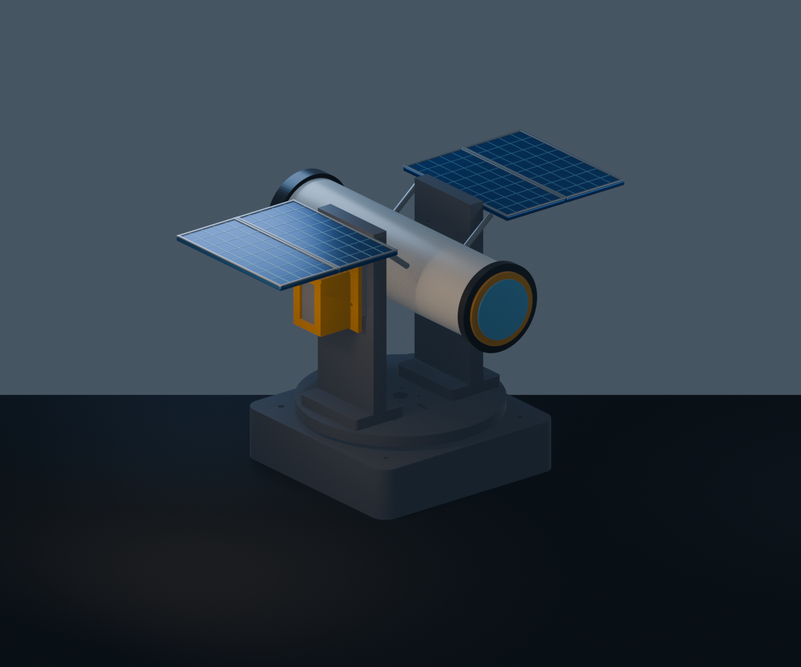

# LEGO Hubble Pan-and-Tilt Display Mount

Parametric CAD and control software for a motorized display stand for the
[LEGO Icons Hubble Space Telescope, set 11382](https://www.lego.com/). The stand
uses two Feetech STS3215-C044 bus servos: one for pan and one for tilt.

> **Prototype status:** this project is an evolving fit-check design. It has
> not been load-qualified or validated with the LEGO telescope attached. The
> Hubble model shown here is an approximate visual envelope, not a brick-accurate
> assembly. Read [Project status](docs/project-status.md) before printing or
> applying power.



The tilt axis uses a driven cross socket on one side and a bearing-free printed
pivot on the other. [Open the interactive assembly viewer](Hubble_Assembly_Viewer.html)
or see the [tilt interface close-up](exports/holder_interface_detail.png).

## Current design at a glance

- **Pan:** the lower STS3215 turns the deck through a horn adapter. A purchased
  100 mm turntable bearing carries the deck and yoke loads; the servo transmits
  rotation only. The base output port stays centered while the servo case sits
  12.5 mm off to one side to follow the datasheet output-axis offset.
- **Tilt:** a U-shaped yoke spans the two reported LEGO side features at about
  105 mm centre-to-centre. The tilt servo drives one cross socket through a
  horn. Its output shaft is not intended to carry the telescope's radial load.
- **Passive tilt side:** `tilt_passive_printed_pivot` replaces the 608 bearing
  on the non-motorized yoke. Its nominal 21.6 mm journal runs directly in the
  yoke's nominal 22 mm bore, and its female cross socket accepts the opposite
  LEGO feature. It is a plain printed-plastic pivot, so expect more friction
  and wear than a rolling bearing.
- **Important bearing requirement:** the current design still requires the
  100 mm pan turntable bearing and one 608 bearing on the motorized tilt side.
  If you have no bearings at all, the stand is not yet fully bearing-free.
- **Motion intent:** software limits target about ±120° pan and ±30° tilt.
  Mechanical stops, swept clearances and cable routing still need physical
  verification.

## Current printable parts

Dimensions are millimetres. The STL files are sliced meshes; STEP files are
provided for editing. `src/hubble_stand.py` is the source of truth.

| Part | Purpose | Current print status |
|---|---|---|
| [base](exports/base.stl) | Stationary base; shifted pan-servo cavity and rail seats | Revised, unprinted |
| [pan_deck](exports/pan_deck.stl) | Rotating plate and yoke mounting surface | Existing design |
| [yoke_left](exports/yoke_left.stl), [yoke_right](exports/yoke_right.stl) | Tilt support arms | Existing printed parts; hole geometry unchanged |
| [servo_retainer](exports/servo_retainer.stl) × 2 | Pan servo retaining rails | Existing printed parts; install at the shifted base coordinates |
| [pan_drive_adapter](exports/pan_drive_adapter.stl) | Pan horn-to-deck connection | Existing design |
| [tilt_drive_socket](exports/tilt_drive_socket.stl) | Driven LEGO cross socket and horn flange | Existing design |
| [tilt_passive_printed_pivot](exports/tilt_passive_printed_pivot.stl) | Passive-side cross support, directly in yoke bore | New; print and fit-test unloaded |
| [tilt_servo_bracket](exports/tilt_servo_bracket.stl) | Existing tilt servo mounting plate | Already printed; output and bolt holes unchanged |
| [tilt_servo_retainer](exports/tilt_servo_retainer.stl), [lid](exports/tilt_servo_retainer_lid.stl) | Case cradle and removable lid for offset tilt servo | Revised, unprinted |

Matching STEP files are alongside each STL in [`exports/`](exports/). Archived
versions of the earlier passive sleeves are in
[`exports/archive/`](exports/archive/) and are not used by the current assembly.

## View the project

- [Interactive HTML viewer](Hubble_Assembly_Viewer.html) — orbit, zoom, select,
  focus and hide/show assembly groups. It embeds the GLB but loads Three.js from
  jsDelivr, so it needs an internet connection.
- [Assembly GLB](exports/visual_model.glb) — open in Blender or another GLB viewer.
- [Assembly STEP](exports/assembly_layout.step) — CAD layout with purchased
  parts shown as simplified envelopes.
- [360° orbit video](exports/visual_360.mp4)
- [Overview render](exports/holder_overview.png) and
  [tilt interface detail](exports/holder_interface_detail.png)

The visual Hubble shell, solar arrays and LEGO side features are illustrative.
They are not load-bearing CAD and do not prove collision-free motion.

## Regenerate the CAD and views

The checked-in CAD exports were generated with CPython 3.13.14 and CadQuery
2.8.0. On Windows, create a Python 3.13 virtual environment and install the
pinned direct dependencies:

    py -3.13 -m venv .venv
    .\.venv\Scripts\Activate.ps1
    python -m pip install --upgrade pip
    python -m pip install -r requirements.txt

Then from the repository root regenerate CAD with:

```powershell
python src/hubble_stand.py
```

This writes component STEP/STL pairs and the assembly STEP/GLB to `exports/`.
To rebuild the approximate telescope scene and browser viewer, use Blender 5.x
and run:

```powershell
blender -b --python src/make_visual_model.py
python src/make_html_viewer.py
```

To render a new orbit video, Blender 5.x and `ffmpeg` must be on `PATH`:

```powershell
blender -b --python src/render_360_video.py
```

See [`exports/README.md`](exports/README.md) for artifact names and
[`docs/assembly_notes.md`](docs/assembly_notes.md) for the intended stack.

## Motor control

The small local jog controller runs with:

```powershell
python src/motor_control_web.py
```

or launch `run_motor_control.bat`. It serves `http://127.0.0.1:8765`, uses
COM5 by default, and addresses servo IDs 1 and 2. Connecting is explicit; no
movement command is sent until a jog button is held. Release the button or use
**Stop all** to stop jogging. Read the [motor-control notes](docs/motor-control.md)
and [hardware test log](docs/hardware-test-log.md) before use. The safer
read-only servo check is:

```powershell
python src/test_servos.py --port COM5 --ids 1 2
```

## Inputs and assumptions

The project includes the supplied Feetech C044 datasheet and servo STEP model
under [`reference/`](reference/). The LEGO instruction PDF was not copied into
this repository; it contains assembly illustrations rather than a dimensioned
or brick-accurate telescope model. Refer to [`reference/README.md`](reference/README.md)
for the input inventory and exclusions.

Key user-supplied inputs are a telescope mass of about 925 g without its LEGO
stand, and two opposing side cross features about 105 mm apart near the centre
of mass. The exact centre of mass, attachment profile, useful axle depth and
orientation remain to be measured. Do not treat provisional CAD dimensions as
verified LEGO dimensions.

## Documentation

- [Project status and open decisions](docs/project-status.md)
- [Mechanical architecture](docs/design-overview.md)
- [Engineering assumptions and torque sizing](docs/engineering_notes.md)
- [Assembly and fit procedure](docs/assembly_notes.md)
- [Motor-control setup and safeguards](docs/motor-control.md)
- [Bench test history](docs/hardware-test-log.md)
- [Preliminary bill of materials](docs/bill-of-materials.md)
- [Verification and release plan](docs/verification-plan.md)
- [Contribution workflow](CONTRIBUTING.md)

## Repository maturity, setup and reuse

Direct dependencies are pinned in [requirements.txt](requirements.txt).
Transitive package versions are not fully locked.

The repository does not currently have a continuous-integration workflow or an
automated mechanical regression suite. The servo scripts are for explicitly
prompted bench checks and are not a substitute for the staged physical checks
in the [verification plan](docs/verification-plan.md). A successful export is
not evidence of structural strength, safe motion or telescope fit.

Before changing the design, read [the contribution workflow](CONTRIBUTING.md),
[the preliminary bill of materials](docs/bill-of-materials.md) and
[the verification plan](docs/verification-plan.md). The [project status](docs/project-status.md)
is the current list of unresolved fit, hardware and safety checks.

No software or design reuse license has been selected for this repository.
The absence of a license file means no open-source redistribution permission
is stated here; ask the repository owner before reusing or redistributing the
work.

## Repository map

- src/ — parametric CAD, viewer generation, rendering and servo-control tools.
- exports/ — current CAD parts, assemblies, renders and archived iterations.
- reference/ — supplied servo datasheet and reference CAD.
- docs/ — design rationale, assumptions, assembly instructions, test history,
  procurement BOM, project status and release verification gates.
- web/ — local servo jog-control interface.
- CONTRIBUTING.md — change-control rules and protected servo-axis interfaces.
