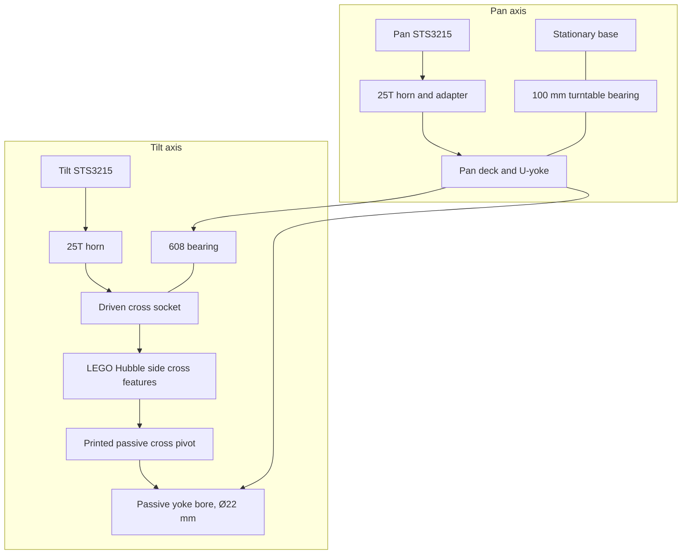

# Mechanical architecture

## System layout

The diagram shows the intended functional path, not a precise exploded view.
The STEP assembly and interactive viewer are better for spatial placement.

## Pan structure

The base is stationary. Its output port stays centered at `(x,y)=(0,0)`. The
servo case is offset by 12.5 mm in X to place the off-centre output shaft on
that port. The servo-retainer rails are reused without changing their geometry;
the base pockets and insert pilots move with the servo case. A separate
turntable bearing carries axial and radial structure loads between base and
deck. The pan horn and adapter transmit torque only.

## Tilt structure

Two printed yoke uprights attach to the pan deck. Their nominal pivot axes are
105 mm apart, matching the user-reported spacing of the LEGO side features. On
the driven side, a 608 bearing supports the trunnion; the tilt servo turns it
through a horn and printed cross socket. On the passive side, the new
`tilt_passive_printed_pivot` fills the yoke's 22 mm bore directly. Its female
cross socket couples to the far LEGO feature, while its round outer journal
slides against the printed yoke bore.

The passive pivot is intentionally separate from the old 7.6 mm journal that
fit inside a 608 bearing. Only the 21.6 mm direct-to-yoke pivot is part of the
current assembly. Older sleeve variants are preserved in `exports/archive/`.

## Load paths

- **Pan:** model and yoke loads pass through the turntable bearing to the base.
  The pan servo output supplies rotational torque.
- **Tilt, driven side:** radial load passes through the cross socket journal,
  608 bearing and yoke. The servo shaft supplies torque through its horn.
- **Tilt, passive side:** radial load passes through the printed pivot journal
  into the yoke. This is a plain plastic sliding interface, not a rolling
  bearing; wear, friction, creep and print orientation require testing.

## Parametric source

`src/hubble_stand.py` is the dimensional source of truth. Its constants and
part functions generate individual STL/STEP files and the assembly layout. All
dimensions are millimetres. User measurements, datasheet dimensions and
assumptions are identified in `docs/engineering_notes.md` and in code comments.

The Hubble mock-up is made separately by `src/make_visual_model.py`; it is only
for orientation and does not define the LEGO attachment or swept envelope.
